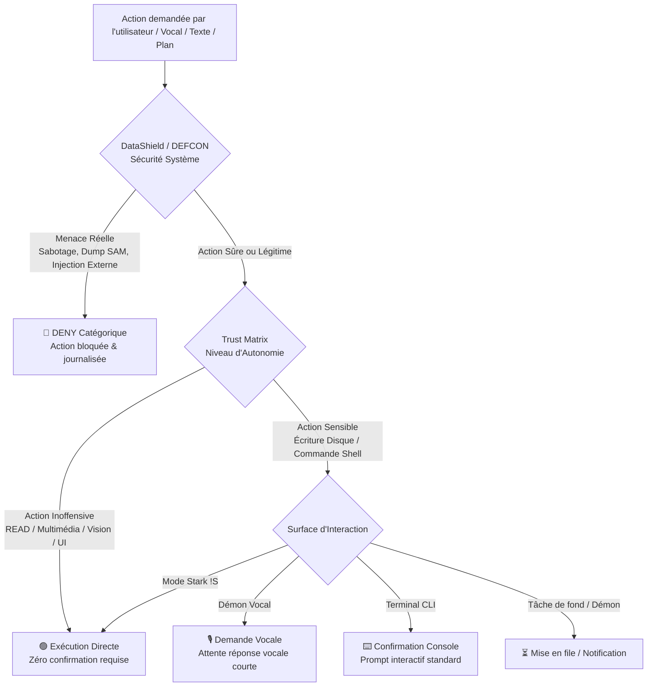

# CHANTIER ARCHITECTURE : Autonomie & Gouvernance GreatOS
## Harmonisation DataShield, Posture DEFCON et Trust Matrix

**Date de création** : 09 octobre 2026  
**Auteur** : Antigravity & Carl  
**Statut** : Cadrage validé / En cours  
**Cible** : GreatOS (J.A.R.V.I.S.)  

---

## 1. Contexte & Diagnostic

### 1.1 Le constat
En conditions réelles d'utilisation, l'utilisateur a l'impression d'être enfermé dans une posture ultra-sécuritaire permanente (type **DEFCON 3**), alors même que le système est nominalement en **DEFCON 5** (paix totale).

### 1.2 La cause racine
Une friction structurelle découle du chevauchement non synchronisé de trois sous-systèmes distincts :

1. **DataShield & DEFCON** (`datashield/policy.py`, `datashield/defcon.py`) :
   * Rôle prévu : Sécurité souveraine, cyber-défense, détection des techniques MITRE ATT&CK et blocage des injections externes.
   * Réalité : Il fait son travail et autorise les actions ordinaires (`RiskLevel.READ`, multimédia, vision d'écran).

2. **La Trust Matrix** (`context_engine/trust_registry.py` - Jalon 5) :
   * Rôle prévu : Apprentissage progressif de l'autonomie par domaine et par utilisateur.
   * Réalité : Tout domaine ou outil nouvellement sollicité démarre par défaut au **Niveau 0 (*Observation*)**. Il exige **5 succès consécutifs validés manuellement au clavier** pour acquérir l'autonomie (Niveau 2).
   * Conséquence : Des actions élémentaires et inoffensives (ex. `controler_multimedia` pour baisser le son) se retrouvent interceptées par `_confirmer_selon_confiance()` avec le message anxiogène :  
     `⚠️ Action sensible : (niveau de confiance GreatOS) exécuter controler_multimedia`  
     `Confirmer ? (o/n) >`

3. **Le mécanisme d'interaction de confirmation** (`taskflow/tools.py`) :
   * Utilisation d'un appel bloquant `_console.input()` au milieu de l'exécution.
   * Totalement inadapté à un assistant vocal temps réel (`scripts/jarvis_live_daemon.py`) ou aux tâches d'arrière-plan, provoquant des gels de threads et obligeant l'utilisateur à reprendre son clavier pour une interaction vocale élémentaire.

---

## 2. Objectifs du Chantier

* **Objectif 1 (Zéro friction sur l'inoffensif)** : Toute action de lecture, vision d'écran, consultation d'état, contrôle multimédia ou gestion de fenêtre doit s'exécuter immédiatement sans aucune interruption utilisateur.
* **Objectif 2 (Découplage clair Sécurité vs Confort)** :
  * *DataShield* décide si une action est **dangereuse ou malveillante** (rejet catégorique).
  * *Trust Matrix* décide du **degré de proactivité** (notification, proposition ou action silencieuse), mais ne doit jamais réintroduire de blocage sur des actions inoffensives.
* **Objectif 3 (Confirmation non-bloquante et multi-surface)** :
  * En mode vocal : validation vocale fluide (*« Sir, dois-je modifier ce fichier ? »* $\rightarrow$ *« Oui vas-y »*), sans freeze clavier.
  * En mode démon : refus ou mise en attente événementielle sans blocage de boucle.
* **Objectif 4 (Posture et transparence d'état)** :
  * Afficher clairement au lancement et dans les logs l'état exact : Posture DEFCON, Mode Stark, et profil actif.

---

## 3. Architecture Cible

---

## 4. Plan d'Implémentation & Lots de Travail

### Lot 1 : Initialisation & Exemptions Native de la Trust Matrix
* **Fichiers cibles** : `context_engine/trust_registry.py`, `jarvis/agent.py`.
* **Actions** :
  1. Définir une liste de domaines et capacités nativement sûrs (*Safe Domains*) :
     * Multimédia & Audio (`controler_multimedia`, volume, mute, etc.).
     * Vision & Perception d'écran (`analyser_ecran`, capture, OCR).
     * Lectures système & métriques (`rapport_systeme`, `top_fichiers_lourds`, `lire_notes`, `lire_preferences`).
     * Gestion des fenêtres UI (`window_manager`, minimiser, verrouiller poste).
  2. Ces capacités doivent nativement débuter au **Niveau 2 (*Action directe*)** ou être exemptées de l'appel `doit_confirmer_action()`.
  3. Mettre à jour le profil existant de l'utilisateur (`learning/profiles/Carl/trust_matrix.json`) pour promouvoir ces domaines.

### Lot 2 : Harmonisation des seuils de risque DataShield vs Trust Matrix
* **Fichiers cibles** : `datashield/policy.py`, `taskflow/tools.py`.
* **Actions** :
  1. Aligner les critères : si `evaluate_capability()` de DataShield renvoie `SecurityDecision.ALLOW` avec `RiskLevel.READ`, la Trust Matrix ne doit pas exiger de confirmation interactive.
  2. Réserver `_confirmer_selon_confiance()` strictement aux opérations de niveau `RiskLevel.WRITE`, `RiskLevel.SYSTEM` ou `RiskLevel.DESTRUCTIVE`.

### Lot 3 : Protocole de confirmation multi-surface (Vocal / CLI / Démon)
* **Fichiers cibles** : `taskflow/tools.py`, `scripts/jarvis_live_daemon.py`, `jarvis/agent.py`.
* **Actions** :
  1. Remplacer le `_console.input()` universel par un gestionnaire de confirmation contextuel dépendant de la surface active :
     * `CLIProvider` : prompt console standard.
     * `VoiceProvider` : question posée par la voix avec écoute dédiée de confirmation (*« Oui / Non »*).
     * `BackgroundProvider` : non-bloquant, mise en pause de la tâche avec émission d'événement sur l'EventBus.
  2. Éviter tout blocage (`freeze`) du thread de capture audio en mode vocal.

### Lot 4 : Posture, Observabilité & Mode Stark
* **Fichiers cibles** : `datashield/defcon.py`, `datashield/safety.py`, `jarvis/interface.py`.
* **Actions** :
  1. Afficher la posture active au boot de Jarvis :
     * `DEFCON: 5 (Nominal)`
     * `Mode: Standard` (ou `Mode: Stark` si actif)
     * `Trust Level: Carl (Profile loaded)`
  2. Permettre le basculement rapide en mode Stark par commande vocale (*« Jarvis, active le protocole Stark »*) avec accusé de réception clair.

---

## 5. Critères de Succès & Tests de Validation

1. **Test Multimédia Vocal** : Dire *« Jarvis, diminue le volume »* $\rightarrow$ Le volume baisse immédiatement sans afficher `⚠️ Action sensible` ni exiger de confirmation au clavier.
2. **Test Vision Vocal** : Dire *« Jarvis, regarde mon écran »* $\rightarrow$ L'analyse s'exécute immédiatement en direct.
3. **Test Sécurité Intacte** : Une tentative d'exécution d'un payload suspect ou de sabotage (ex. `vssadmin delete shadows`) reste bloquée net par DataShield en `DENY`.
4. **Test Écriture Sensible** : Une tentative de modification d'un fichier système ou du noyau Jarvis continue de solliciter une confirmation explicite selon le canal approprié.
5. **Suite de tests automatisés** : 100% de tests au vert sur `pytest tests/`.
