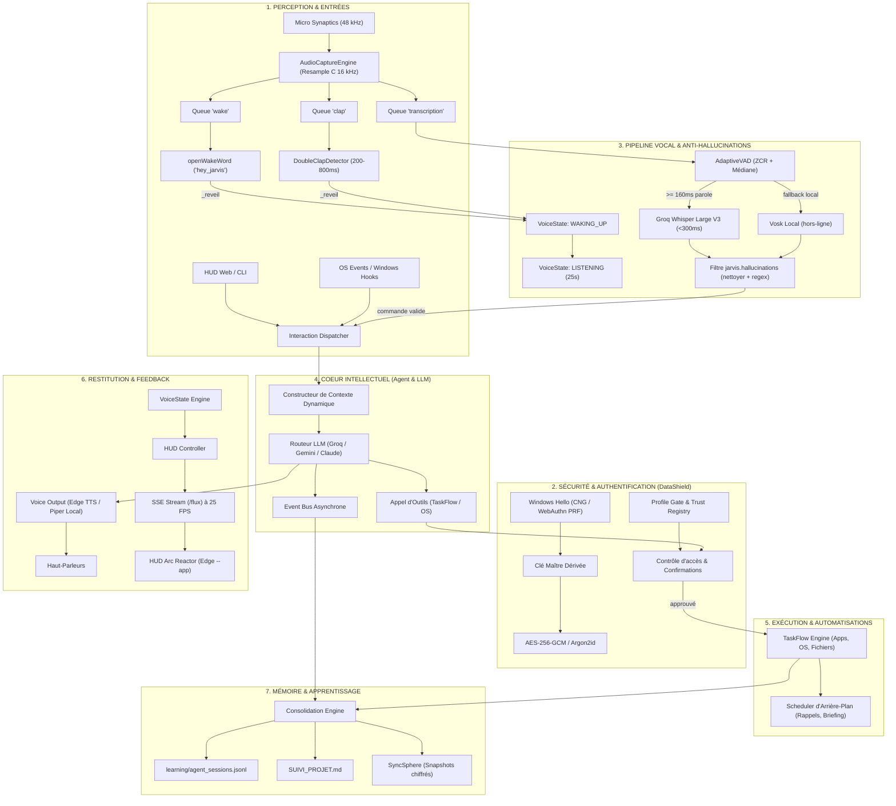

# Architecture Globale & Fonctionnement Interne de GreatOS

Ce document normalise le fonctionnement de GreatOS dans son ensemble. Il décrit le flux de bout en bout, l'articulation des couches internes et les garanties de sécurité, de latence et de mémoire.

---

## 1. Vue d'Ensemble & Chemin Global (Mermaid)

---

## 2. Les 7 Couches Fondamentales de GreatOS

### Couche 1 : Perception Audio & Matérielle (`jarvis/audio_capture.py`)
- **Problème résolu** : Windows bloque les accès multiples exclusifs au microphone et le micro natif (Synaptics) tourne à 48 kHz multicanal alors que les moteurs de voix attendent 16 kHz mono.
- **Fonctionnement interne** :
  - Un unique thread hardware ouvre le micro via `sounddevice`.
  - Rééchantillonnage C haute fidélité (`samplerate.Resampler` sinc_medium) de 48 kHz vers 16 kHz.
  - Sélection automatique du meilleur canal selon l'énergie acoustique.
  - Distribution en éventail (Fan-out) vers 4 files indépendantes sans verrouillage bloquant : `_q_wake`, `_q_clap`, `_q_transcription`, `_q_stop`.

### Couche 2 : Déclenchement & Filtrage Acoustique (`jarvis/clap_input.py`, `jarvis/hallucinations.py`)
- **Wake Word** : Inférence ONNX ultra-légère en continu sur `hey_jarvis` avec mise à jour adaptative du seuil sonore.
- **Double-Clap** : Algorithme déterministe mesurant l'amplitude crête int16 (> 3 000) et la fenêtre temporelle entre deux claquements (200 à 800 ms).
- **Anti-Hallucinations** :
  - `AdaptiveVAD` exige au moins 2 trames (160 ms) de parole cumulée réelle pour éviter d'envoyer un souffle au STT.
  - `jarvis.hallucinations` analyse les transcriptions : élimination de >30 signatures fantômes Whisper, élagage des amorces parasites (*"Jarvis,"*, *"Hey Jarvis"*) et rejet des commandes orphelines.

### Couche 3 : Sécurité Zero-Trust & Chiffrement (`datashield/`)
- **Verrouillage de session** : Détection de l'état de session Windows (verrouillée `WTSRegisterSessionNotification` ou écran de veille). Retour HTTP 423 si la session est verrouillée.
- **Protection des secrets** : Chiffrement AES-256-GCM et dérivation de clé via **Windows Hello CNG** ou PRF WebAuthn.
- **Barrière de profil (`profile_gate.py`)** : Les actions destructives (suppression de fichiers, exécution PowerShell sans garde, modification système) requièrent confirmation explicite (vocale ou visuelle).

### Couche 4 : Le Hub Morphique & Serveur Temps Réel (`interface_morphique/`)
- **FastAPI asynchrone** (port 8000).
- **Système d'états réactif** :
  - `IDLE` (anneau bleu calme, pulsation lente)
  - `WAKING_UP` (son de réveil, anneau orange vif)
  - `LISTENING` (arc reactor cyan réactif au niveau sonore instantané)
  - `THINKING` (rotation accélérée mauve/cyan, calcul LLM)
  - `SPEAKING` (vagues d'amplitude vocale, modulation dynamique)
- **Diffusion SSE (`/flux`)** : Pousse à 25 FPS l'état, l'amplitude, les transcriptions en direct et les notifications vers l'Arc Reactor HTML5.

### Couche 5 : Cœur Intellectuel & Routage Multi-LLM (`core_intellect/`, `jarvis/agent.py`)
- **Gestionnaire de contexte** : Injecte le profil utilisateur, l'état système, les outils disponibles et la mémoire court-terme.
- **Pipeline hybride** :
  - Commandes rapides / réflexes : Routage direct via Groq / LPU (latence ~200 ms).
  - Raisonnement complexe / analyse : Routage vers Claude 3.5 Sonnet ou Gemini Pro.
- **Barge-in (interruption à chaud)** : Si l'utilisateur parle pendant que Jarvis s'exprime, le thread audio détecte l'ordre d'arrêt (*"Stop"*, *"Attends"* ou *"Hey Jarvis"*) et coupe immédiatement le TTS.

### Couche 6 : Moteur d'Action OS & Automatisation (`taskflow/`)
- **Contrôle Windows natif** : Gestion des fenêtres, lancement d'applications (Edge en mode `--app`, VS Code, Terminal), contrôle du volume, capture d'écran, briefing quotidien.
- **Scheduler d'arrière-plan** : Boucle autonome vérifiant les rappels, les automatisations planifiées et la santé du système.

### Couche 7 : Continuité & Apprentissage Structuré (`learning/`, `context_engine/`)
- **Règle AGENTS.md** : Chaque session d'agent ou interaction significative est consignée de manière immuable dans `learning/agent_sessions.jsonl`.
- **Régénération humaine** : `SUIVI_PROJET.md` est recompilé automatiquement pour offrir une vue consolidée de l'état d'avancement.
- **Persistance résiliente** : `SyncSphere` assure la création de snapshots et de sauvegardes protégées.

---

## 3. Chronométrie d'une Requête Vocale Type (Budget Temps : < 1.2s)

| Étape | Composant | Durée moyenne | Action réalisée |
| :--- | :--- | :--- | :--- |
| **T0** | Micro & `AudioCaptureEngine` | ~80 ms | Capture trame 48kHz, resample 16kHz |
| **T0 + 80ms** | `openWakeWord` / `DoubleClap` | ~20 ms | Détection "Hey Jarvis" ou double claquement |
| **T0 + 100ms** | `voice_state.py` & HUD | ~10 ms | Bascule `WAKING_UP` -> `LISTENING`, ping SSE |
| **T0 + 110ms** | `voice_input.py` | ~800 ms | Parole utilisateur capturée jusqu'au silence post-VAD |
| **T0 + 910ms** | `voice_transcription.py` (Groq) | ~220 ms | Groq Whisper Large V3 transcrit en texte pur |
| **T0 + 1130ms** | `jarvis.hallucinations` | ~1 ms | Filtrage anti-hallucination & élagage résidus |
| **T0 + 1131ms** | `core_intellect` (LLM) | ~250 ms | Groq Llama 3 / Mixtral génère la réponse et l'action |
| **T0 + 1381ms** | `voice_output.py` & TTS | ~150 ms | Edge TTS / Piper synthétise et lance la lecture audio |
